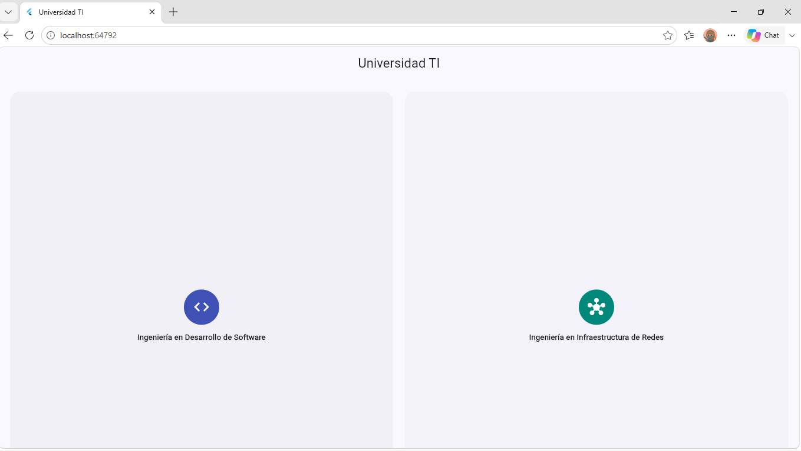
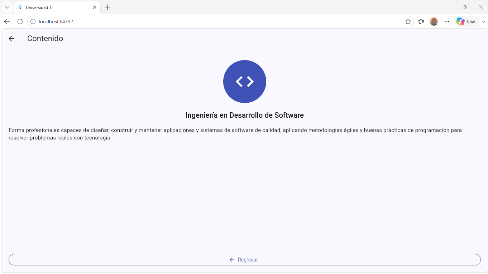
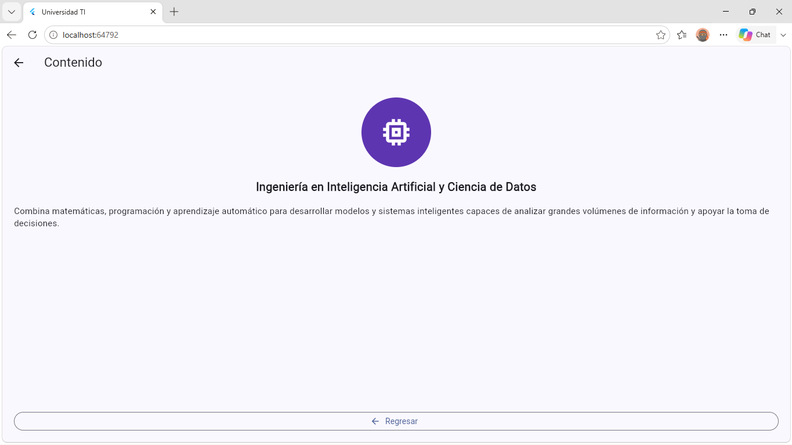
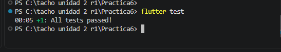

# Práctica 6 · Universidad TI

App en Flutter con la oferta educativa de una universidad tecnológica. La pantalla principal muestra las carreras en una rejilla de dos columnas; al tocar una se abre su detalle con ícono, nombre y descripción, y un botón para regresar.

- **Alumno:** Oscar Manuel Ayala Ortiz
- **Grupo:** GTID244 · **Núm. de control:** 1225100784
- **Materia:** Desarrollo de Aplicaciones Móviles (UTNG)

## Funcionalidades

- Rejilla de 5 carreras (`GridView.builder`, 2 columnas):
  - Ingeniería en Desarrollo de Software
  - Ingeniería en Infraestructura de Redes
  - Ingeniería en Inteligencia Artificial y Ciencia de Datos
  - Licenciatura en Ciencia de Datos
  - Ingeniería en Ciberseguridad
- Cada carrera tiene su propio ícono y color.
- Pantalla de detalle con navegación (`Navigator.push` / `Navigator.pop`) y botón **Regresar**.

## Estructura

Separación sencilla por responsabilidad (modelo, datos y vistas):

```
lib/
├── models/carrera.dart                  Modelo: nombre, ícono, color y descripción
├── Data/carreras_data.dart              Lista con las 5 carreras
├── views/
│   ├── panatalla_principal.dart         Rejilla de carreras
│   └── pantalla_contenido.dart          Detalle de una carrera
├── widgets/tarjeta_carrera.dart         Tarjeta reutilizable de la rejilla
└── main.dart                            Tema y pantalla inicial
```

## Cómo ejecutarla

```
flutter pub get
flutter run -d chrome
flutter test
```

## Evidencia de funcionamiento

| Pantalla principal | Detalle: Desarrollo de Software | Detalle: IA y Ciencia de Datos |
|---|---|---|
|  |  |  |

## Pruebas



`test/widget_test.dart`: abre la app, entra al detalle de Desarrollo de Software, comprueba el contenido y regresa a la lista con el botón **Regresar**.
